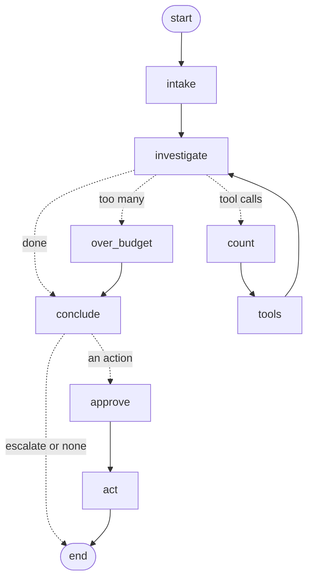

# How firstlook works

## The graph

(Generated with `get_graph().draw_mermaid()` and trimmed for reading.)

- **intake** writes the system prompt and the page: the alerts that are firing.
- **investigate** is the model with six tools bound. It either asks for tools
  or stops.
- **count** and **tools** run the calls. A call the model already made with
  the same arguments isn't run again; it gets told to look at the earlier
  answer. Every tool answer is capped at 1500 characters, and an unknown
  service comes back as an error message naming the real ones, not an
  exception.
- **over_budget** answers any pending calls with "not run" once the budget
  (12 by default) is spent, so the conversation stays valid, and moves on.
- **conclude** asks for a `Finding` with structured output (retried up to 3
  times), then checks it (below).
- **approve** stops the graph with `interrupt()`. Nothing past this point runs
  until a person resumes it with `{"approved": true|false, "by": name}`.
- **act** hands an approved action to an executor. firstlook ships two: a dry
  run that only records it, and one that plays it against a scenario's known
  answer.

## The tools

| Tool | Answers |
|---|---|
| `list_alerts` | what is firing, and the list of services |
| `query_metric` | one metric for one service: now, min, max, and the biggest step change with its time |
| `search_logs` | log lines grouped by message, most frequent first, with first-seen times |
| `recent_deploys` | deploys and feature flag changes, newest first |
| `dependencies` | what a service calls and what calls it |
| `read_runbook` | the team's notes for a service |

The tools read from an `Env`. `ScenarioEnv` serves a recorded scenario;
`LiveEnv` reads Prometheus (`query_range`, plus `ALERTS` and
`ALERTS_FOR_STATE` for alerts) and JSON-lines files for deploys and logs.

## Checks on the conclusion

The model's finding is not trusted as is:

- Each evidence quote must appear in some tool answer (ignoring case and
  whitespace). Quotes that don't are dropped and listed in the note.
- With no evidence left, or naming a service that doesn't exist, the action
  becomes **escalate** with low confidence. The note says what was not done
  and why.
- An action aimed at a service that doesn't exist also becomes an escalation.

So the worst a confused model can do is ask a person to look, which is where
the incident was before firstlook ran.

## Pausing for a person

With `--pause` the run is checkpointed to SQLite at the approval step and the
process exits. `firstlook waiting` lists paused runs, and `firstlook decide
RUN yes|no` resumes one, possibly from another shell or another day. The run
name and model are kept in the checkpoint metadata so the graph can be rebuilt.

## Scenarios

A scenario is a short JSON file: services and what they call, deploys,
metric effects (a step, or a ramp over N minutes), log patterns, runbooks, and
the known answer (`truth`). Metrics and logs are generated from it with fixed
noise, seeded per scenario, so every run sees the same data.

Alerts fire the way a monitoring system's would: a threshold held for a few
minutes (error rate over 5% for 3 minutes, CPU over 90% for 5, and so on).

## The rules baseline

`--model rules` (the default with no `GROQ_API_KEY`) uses no model. It walks
down the call graph from the alerting services, finds the earliest metric
step in any of them (on a tie, the service further down wins), blames a
deploy to that service in the 15 minutes before, and otherwise maps the
metric to a guess (CPU means scale up, rps means rate limit, and so on).

It is there to give the agent something to beat, and its misses are part of
the point. See the README for how it does on the built-in scenarios.

## Evals

`firstlook eval` runs every scenario and scores the finding:

- **service**, **cause**: match the known answer
- **fix**: the proposed action and its target match the known fix
- **harmful**: it proposed changing production (anything but escalate or
  none) and it was the wrong change
- **evidence**: quotes that survived the checks
- **tools**: tool calls made

A scenario is solved when service, cause and fix are all right. The eval
declines every proposal at the approval step, so nothing is carried out.
